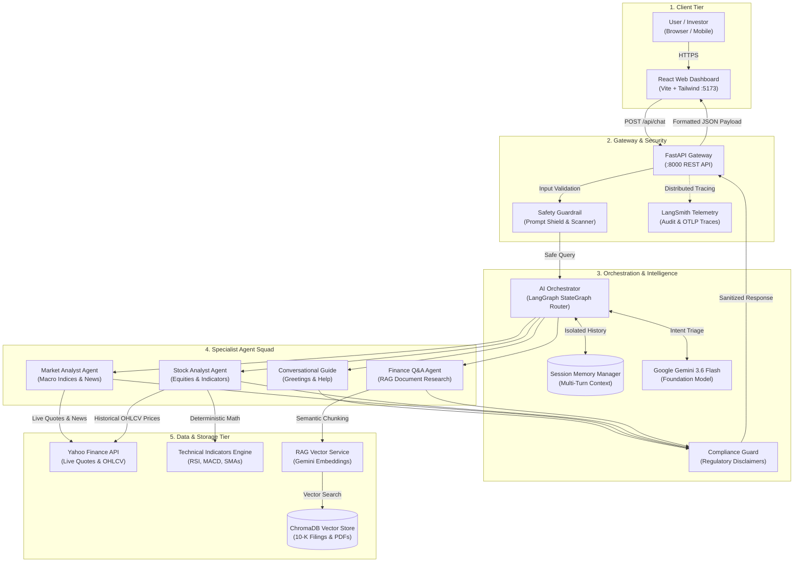
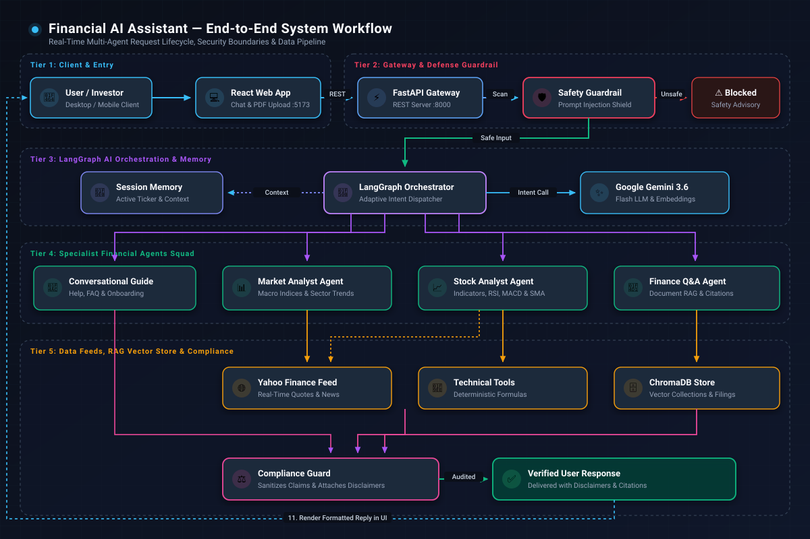
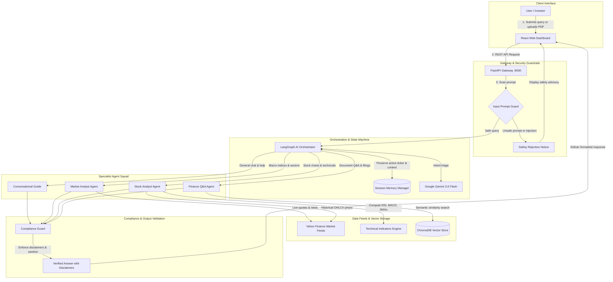
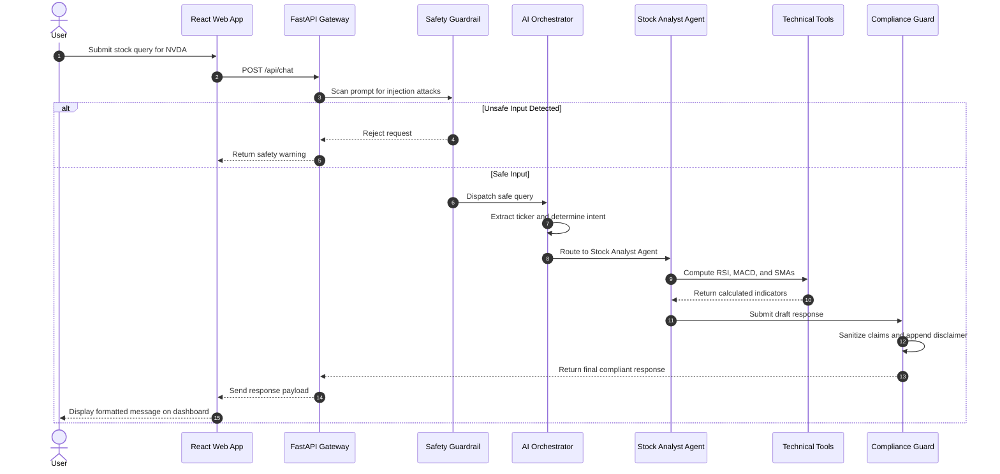

# 📈 Financial AI Assistant

[](https://www.python.org/)
[](https://fastapi.tiangolo.com/)
[](https://react.dev/)
[](https://langchain-ai.github.io/langgraph/)
[](https://ai.google.dev/)
[](https://www.trychroma.com/)
[](https://opensource.org/licenses/MIT)

> **Enterprise-grade multi-agent financial advisory platform** combining deterministic financial computations, real-time market data, grounded document research (RAG), and strict safety & regulatory compliance.

---

## 📖 Table of Contents

- [Executive Summary](#-executive-summary)
- [Application Demo](#-application-demo)
- [System Architecture](#-system-architecture)
  - [Architecture Topology Diagram](#architecture-topology-diagram)
  - [How It Works: Component Breakdown](#how-it-works-component-breakdown)
  - [End-to-End System Flow Diagram](#end-to-end-system-flow-diagram)
  - [Step-by-Step Request Lifecycle](#step-by-step-request-lifecycle)
- [Core Capabilities](#-core-capabilities)
- [Technology Stack](#-technology-stack)
- [Project Directory Structure](#-project-directory-structure)
- [Getting Started](#-getting-started)
  - [Prerequisites](#prerequisites)
  - [Environment Configuration](#environment-configuration)
  - [Local Development Setup](#local-development-setup)
- [Unified Full-Stack Deployment](#-unified-full-stack-deployment)
- [API Reference](#-api-reference)
- [Testing & Quality Assurance](#-testing--quality-assurance)
- [Security, Guardrails & Compliance](#-security-guardrails--compliance)
- [Regulatory Disclaimer](#-regulatory-disclaimer)

---

## 💡 Executive Summary

### What is this application?
The **Financial AI Assistant** is an intelligent investment and market research copilot. Think of it as a team of specialized financial analysts working together at an investment desk:
- **One specialist** checks the latest market news and broad economy trends.
- **Another specialist** computes stock chart indicators like momentum and volatility.
- **A third specialist** reads 100-page corporate financial filings and 10-K reports to answer detailed questions with verifiable citations.
- **A friendly concierge** greets you and helps guide your questions.

### Why not just ask a standard AI chatbot?
General AI chatbots often "hallucinate" (make up numbers), give outdated stock quotes from months ago, or promise unrealistic returns without warning you about financial risk. 

This platform solves those problems by design:
1. **Real-Time Data**: Live market quotes and charts are pulled directly from Yahoo Finance.
2. **Exact Math**: Technical indicators (such as RSI and Moving Averages) are calculated using mathematical algorithms, never guessed by language models.
3. **Grounded In Truth**: Questions about corporate reports are answered strictly using facts extracted from uploaded PDFs and indexed into a searchable vector knowledge base.
4. **Safety & Guardrails**: Dangerous commands and prompt injections are filtered out at the door.
5. **Regulatory Compliance**: Every financial response is automatically audited and stamped with mandatory compliance disclosures to protect users.

---

## 🎬 Application Demo

Experience the **Financial AI Assistant** in action across real-time market analysis, automated stock technical charts, grounded corporate filing analysis (RAG), and multi-turn financial advisory:

<div align="center">
  <video src="https://raw.githubusercontent.com/anishchandak7/financial-ai-assistant/master/docs/demo.mp4" controls="controls" muted="muted" width="100%" style="max-height: 520px; border-radius: 8px;">
    <a href="docs/demo.mp4">▶ Click here to view the demo video</a>
  </video>
</div>

> 🎬 **Demo Video Player**: [**▶ Open in GitHub Video Player**](docs/demo.mp4) &bull; [**Direct Download (MP4)**](https://raw.githubusercontent.com/anishchandak7/financial-ai-assistant/master/docs/demo.mp4)

---

## 🏛️ System Architecture

### Architecture Topology Diagram

The multi-agent financial assistant topology illustrates the end-to-end separation of concerns across client, gateway, orchestration, specialist agents, and data storage:

[](docs/architecture.html)

> 💡 **Interactive Architecture Viewer**: An interactive canvas generated with **Archify** is available at [`docs/architecture.html`](docs/architecture.html). You can open it directly in your browser (`docs/architecture.html`) to pan, zoom, inspect component dependencies, and trace data contracts. *(Note: GitHub Markdown does not execute live `<iframe>` tags for security reasons, so the interactive canvas is provided as a standalone viewer file).*

<details>
<summary><b>🔍 View Native Mermaid Architecture Topology</b></summary>



</details>

---

### How It Works: Component Breakdown

The architecture is divided into five logical tiers:

| Tier | Component | Role & Plain-English Description | Code Anchor |
| :--- | :--- | :--- | :--- |
| **Client Tier** | `User / Investor` | Interacts via desktop web browser or mobile device. | Desktop / Mobile Client |
| | `React Web App` | Modern single-page interface with real-time stock ticker banners, chat bubbles, document uploads, and citation inspectors. | [`webapp/src/App.jsx`](webapp/src/App.jsx) |
| **Gateway & Security** | `FastAPI Gateway` | High-performance REST API handling requests, CORS policies, and streaming. | [`backend/server.py`](backend/server.py) |
| | `LangSmith Telemetry` | Distributed tracing recording token consumption, latency, and step-by-step agent decisions. | [`backend/observability/middleware.py`](backend/observability/middleware.py) |
| | `Safety Guardrail` | Security shield scanning incoming queries for jailbreak attempts, system prompt manipulation, or adversarial attacks before any AI executes. | [`backend/agents/guardrails/prompt_guard.py`](backend/agents/guardrails/prompt_guard.py) |
| **Intelligence & Memory** | `AI Orchestrator` | The "lead dispatcher" (powered by LangGraph StateGraph) that categorizes the user's intent and dynamically assigns the query to the best specialist agent. | [`backend/agents/orchestrator/router.py`](backend/agents/orchestrator/router.py) |
| | `Session Memory` | Remembers multi-turn context (e.g., active stock tickers and prior questions) across distinct agent interactions. | [`backend/memory/manager.py`](backend/memory/manager.py) |
| | `Google Gemini AI` | Gemini 3.6 Flash foundation model powering reasoning, document comprehension, and intent classification. | Foundation Model |
| | `Compliance Guard` | Scans draft agent responses to remove unlicensed return promises (e.g. "guaranteed profits") and attaches required regulatory disclaimers. | [`backend/agents/guardrails/compliance.py`](backend/agents/guardrails/compliance.py) |
| **Specialist Agents** | `Conversational Agent` | Greets users, explains what the assistant can do, and guides onboarding. | [`backend/agents/specialists/conversational.py`](backend/agents/specialists/conversational.py) |
| | `Market Analyst Agent` | Analyzes macro indices (S&P 500, Nasdaq, Dow), sectors, and economic sentiment. | [`backend/agents/specialists/market_analyst.py`](backend/agents/specialists/market_analyst.py) |
| | `Stock Analyst Agent` | Examines specific equities, chart trends, and valuation metrics. | [`backend/agents/specialists/stock_analyst.py`](backend/agents/specialists/stock_analyst.py) |
| | `Finance Q&A (RAG) Agent` | Explains complex financial terms and retrieves factual data from uploaded 10-K filings. | [`backend/agents/specialists/finance_qa.py`](backend/agents/specialists/finance_qa.py) |
| **Data, Tools & Knowledge** | `Technical Indicators Engine` | Computes mathematical metrics (RSI, MACD, 20/50/200 SMAs, Bollinger Bands) to guarantee deterministic numerical accuracy. | [`backend/agents/tools/technical_indicators.py`](backend/agents/tools/technical_indicators.py) |
| | `Market Tools & Feeds` | Interfaces with Yahoo Finance for live stock quotes, price history, and news. | [`backend/agents/tools/market_tools.py`](backend/agents/tools/market_tools.py) |
| | `RAG Vector Service` | Splits financial documents into semantic chunks and converts them into dense vector embeddings. | [`backend/rag/vector_store.py`](backend/rag/vector_store.py) |
| | `ChromaDB Storage` | Vector database organizing embeddings across specialized financial collections (`Finance`, `Portfolio`, `MarketAnalysis`, `Tax`, etc.). | [`vectorstore/chromadb`](vectorstore/) |
| | `Yahoo Finance API` | External live market feed provider for current equity prices and historical OHLCV data. | External Service |

---

### End-to-End System Flow Diagram

The complete end-to-end request lifecycle—from client intake through input safety scans, LangGraph agent triage, tool execution, and compliance auditing—is illustrated below:



<details>
<summary><b>🔍 View Raw Mermaid Flowchart Code</b></summary>



</details>

---

### Step-by-Step Request Lifecycle

1. **Intake & Transport**: The user submits a prompt or uploads a document in the React Single-Page Application (`:5173`), sending an HTTP `POST /api/chat` request with a persistent `session_id` to the FastAPI backend (`:8000`).
2. **Pre-Execution Safety Scan**: The `input_guardrail_node` runs the query through the prompt shield runnable. Adversarial jailbreaks or system instruction overrides are blocked with an advisory response without invoking downstream models.
3. **Intent Triage & Dispatch**: Safe queries pass to the `triage_node`. The adaptive router evaluates intent and extracts active ticker symbols (e.g., `AAPL`, `NVDA`), retrieving previous context from `SessionMemoryManager`.
4. **Specialist Execution**:
   - **Market Analysis Agent**: Queries macro market telemetry and indices via `market_tools`.
   - **Stock Analyzer Agent**: Fetches historical OHLCV data from Yahoo Finance and runs deterministic indicator math (RSI, MACD, SMAs).
   - **Finance Q&A Agent**: Uses Google Gemini embeddings to perform vector similarity search across indexed ChromaDB document collections, returning exact citations.
   - **Conversational Agent**: Handles greetings, navigation questions, and general guidance.
5. **Output Compliance Enforcer**: Specialist outputs pass through `compliance_node`. High-risk financial claims (e.g. "guaranteed returns") are sanitized, and mandatory regulatory disclaimers are attached.
6. **Delivery & UI Presentation**: The final response is returned to the user interface, rendering formatted markdown, interactive metric badges, and citation sources.

<details>
<summary><b>🔍 View Sequence Diagram (Mermaid)</b></summary>



</details>

---

## 🚀 Core Capabilities

- **Multi-Agent Collaboration**: Driven by LangGraph, user queries are automatically directed to dedicated experts without manual mode switching.
- **Deterministic Technical Indicators**: Real-time evaluation of:
  - Relative Strength Index (RSI - 14 period)
  - Moving Average Convergence Divergence (MACD, Signal, Histogram)
  - Simple & Exponential Moving Averages (SMA 20, 50, 200, EMA 12, 26)
  - Bollinger Bands (Upper, Middle, Lower, Bandwidth)
  - Automatic Golden Cross / Death Cross identification
- **Document RAG with Citations**: Upload corporate filings (PDF/TXT), which are parsed, embedded via Google Generative AI embeddings, and indexed into ChromaDB. Specialist agents cite exact document passages and page references.
- **Multi-Turn Session Memory**: Per-agent isolated memory partitions remember the active stock symbol and earlier dialogue turns within the conversation.
- **Dual-Layer Defense**:
  - *Input Guardrail*: Filters prompt injections, system leaks, and malicious scripts.
  - *Output Guardrail*: Strips illegal guarantees and enforces compliance disclaimers.
- **Unified Deployment Ready**: Preconfigured for seamless single-service full-stack deployment on [Render](https://render.com/).

---

## 🛠️ Technology Stack

| Layer | Technologies |
| :--- | :--- |
| **Frontend** | React 18, Vite, Tailwind CSS, Heroicons, DOMPurify, Marked |
| **Backend & APIs** | Python 3.12, FastAPI, Uvicorn, Pydantic v2 |
| **Agentic AI & Orchestration** | LangGraph, LangChain Core, LangChain Google GenAI, Google Gemini 3.6 Flash |
| **Data & Financial Math** | yfinance, pandas, numpy, ChromaDB |
| **Observability & Tracing** | LangSmith, OpenTelemetry Trace Spans, Python Structured Logging |
| **Architecture Specification** | Archify v3.0 (Validated Showcase Profile) |

---

## 📂 Project Directory Structure

```plaintext
financial-ai-assistant/
├── .archify/                         # Archify architecture diagrams & receipts
│   └── architecture-overview-20261012-025500/
│       ├── candidate.json            # Typed architecture specification
│       ├── financial-assistant-architecture.html # Standalone interactive diagram
│       └── financial-assistant-architecture.svg  # Extracted vector graphic
├── backend/                          # FastAPI & Multi-Agent Backend
│   ├── agents/                       # LangGraph multi-agent implementation
│   │   ├── guardrails/               # Input safety & compliance runnables
│   │   ├── orchestrator/             # StateGraph workflow & adaptive triage router
│   │   ├── specialists/              # Specialist agents (Stock, Market, QA, Chat)
│   │   └── tools/                    # Technical indicators & Yahoo Finance tools
│   ├── api/v1/                       # Modular FastAPI endpoints
│   │   └── endpoints/                # Chat, Market, Documents, Models, Health
│   ├── core/                         # Configuration & Pydantic settings
│   ├── evals/                        # Evaluation benchmarks & metrics
│   ├── memory/                       # Multi-turn isolated session memory manager
│   ├── observability/                # Middleware, logger, and LangSmith tracing
│   ├── rag/                          # ChromaDB vector store & document chunking
│   ├── tests/                        # Comprehensive unit & integration tests
│   ├── pyproject.toml                # Backend package metadata
│   ├── requirements.txt              # Production Python dependencies
│   └── server.py                     # Main FastAPI application server & SPA host
├── docs/                             # Documentation assets & diagram artifacts
│   ├── architecture.html             # Standalone interactive architecture viewer
│   ├── architecture.svg              # Embedded architecture vector graphic
│   └── demo.mp4                      # Full application walkthrough & demo video
├── webapp/                           # React + Vite Frontend Application
│   ├── src/
│   │   ├── components/               # ChatInterface, MarketTicker, DocumentUploadModal
│   │   ├── services/                 # API client & streaming fetchers
│   │   ├── App.jsx                   # Single-Page Dashboard assembly
│   │   └── index.css                 # Styling tokens & Tailwind styles
│   ├── package.json                  # Frontend dependencies & scripts
│   └── vite.config.js                # Vite build configuration
├── vectorstore/                      # ChromaDB persistent vector storage
├── build.sh                          # Unified deployment build script
├── render.yaml                       # Render.com Blueprint configuration
└── README.md                         # Project documentation
```

---

## ⚡ Getting Started

### Prerequisites

- **Python**: Version `3.11` or `3.12`
- **Node.js**: Version `18.x` or higher
- **Google Gemini API Key**: Obtainable from [Google AI Studio](https://aistudio.google.com/)

---

### Environment Configuration

Create a `.env` file in the `backend/` directory (or copy from `backend/.env.example`):

```bash
cp backend/.env.example backend/.env
```

Populate the required environment variables:

```ini
# Google Gemini API Configuration
GEMINI_KEY="your-google-gemini-api-key"

# Vector Store Settings
CHROMA_DB_PATH="vectorstore/chromadb"
COLLECTION_NAMES="Finance, Portfolio, MarketAnalysis, Goals, News, Tax"

# Market Coverage
MARKETS="US, GB, ASIA, EUROPE, RATES, COMMODITIES, CURRENCIES, CRYPTOCURRENCIES"

# Optional: LangSmith Observability & Tracing
LANGSMITH_TRACING="false"
# LANGSMITH_API_KEY="your-langsmith-key"
# LANGSMITH_PROJECT="financial-ai-assistant"

# Optional: Allowed CORS Origins (comma-separated or * for development)
ALLOWED_ORIGINS="*"
```

---

### Local Development Setup

#### 1. Start the Backend API Server

Open a terminal and set up the Python environment:

```bash
# Navigate to backend directory
cd backend

# Create and activate virtual environment
python -m venv .venv

# On Linux / macOS:
source .venv/bin/activate
# On Windows (PowerShell):
.venv\Scripts\Activate.ps1

# Install dependencies
pip install -r requirements.txt

# Start FastAPI development server
uvicorn server:app --reload --port 8000
```

The API server will be available at: **`http://localhost:8000`**  
Interactive Swagger API Documentation: **`http://localhost:8000/docs`**

#### 2. Start the Frontend Web Application

Open a second terminal window:

```bash
# Navigate to webapp directory
cd webapp

# Install Node dependencies
npm install

# Start Vite development server
npm run dev
```

The React dashboard will be running at: **`http://localhost:5173`**

---

## 🚢 Unified Full-Stack Deployment

The project includes automated scripts to package the React frontend into static assets served directly by the FastAPI backend, enabling single-container deployments on **Render**, **Railway**, **Docker**, or any VPS.

### Build Script (`build.sh`)
```bash
bash build.sh
```
This script:
1. Installs all backend Python requirements.
2. Compiles the React application (`webapp/dist`).
3. Makes frontend assets available to FastAPI at `backend/dist` / `webapp/dist`.

### Run Production Server
```bash
uvicorn server:app --host 0.0.0.0 --port 8000 --app-dir backend
```
When running in production, opening `http://localhost:8000` serves the complete unified web application, with all API endpoints active under `/api/...`.

### Deploying on Render (`render.yaml`)
A ready-to-use [`render.yaml`](render.yaml) blueprint is provided:
1. Connect your GitHub repository to Render.
2. Create a new **Web Service** from Blueprint.
3. Add your `GEMINI_KEY` secret under Environment Variables.
4. Render automatically executes `bash build.sh` and starts the app with zero manual configuration.

---

## 📡 API Reference

| Method | Endpoint | Description |
| :--- | :--- | :--- |
| `POST` | `/api/chat` | Send a prompt to the multi-agent system. Supports session continuation. |
| `GET` | `/api/market/quote/{ticker}` | Retrieve real-time pricing and basic metrics for a stock ticker. |
| `GET` | `/api/market/technical/{ticker}` | Compute mathematical technical indicators (RSI, MACD, SMAs). |
| `POST` | `/api/documents/upload` | Upload a PDF/TXT document to ingest into the ChromaDB vector index. |
| `GET` | `/api/models` | List supported language model configurations. |
| `GET` | `/api/health` | Service health check, active collections, and telemetry status. |

### Sample Chat Request
```http
POST /api/chat HTTP/1.1
Content-Type: application/json

{
  "query": "Is Apple (AAPL) overbought right now? What is its RSI and 50-day moving average?",
  "session_id": "session-user-12345",
  "model_name": "gemini-3.6-flash"
}
```

### Sample Chat Response
```json
{
  "response": "Apple Inc. (AAPL) is currently trading at $235.40.\n\n### Technical Indicator Analysis:\n- **RSI (14-period)**: 61.2 (Neutral-to-Bullish, below the 70 overbought threshold).\n- **50-Day SMA**: $228.15 (Price is currently trading above this support line).\n- **200-Day SMA**: $204.80.\n\n**Verdict**: AAPL is not currently in an overbought condition.\n\n---\n*Disclaimer: Market data and quantitative insights provided are strictly for informational and educational purposes only. They do not constitute financial advice.*",
  "active_agent": "Stock Analyzer Agent",
  "ticker": "AAPL",
  "citations": []
}
```

---

## 🧪 Testing & Quality Assurance

Run the test suite using `pytest`:

```bash
cd backend
pytest tests/ -v
```

The test suite covers:
- **`test_prompt_guard.py`**: Verifies injection blocking and adversarial input detection.
- **`test_orchestrator_router.py`**: Validates routing decisions across different user intents.
- **`test_stock_analyzer.py`**: Asserts mathematical accuracy of RSI, MACD, and Bollinger computations.
- **`test_rag.py`**: Tests document chunking, embedding generation, and ChromaDB retrieval.
- **`test_agent_memory.py`**: Checks session isolation, scratchpad state, and active ticker tracking.
- **`test_observability.py`**: Verifies request correlation IDs and telemetry middleware.

---

## 🛡️ Security, Guardrails & Compliance

1. **Input Prompt Shield**: Every input passes through `input_guardrail_runnable` before any agent or LLM is triggered. Malicious prompts, attempt to override instructions, or prompt injections are rejected.
2. **Deterministic Computation**: Calculations are never left to generative LLM hallucination; numerical indicators are computed directly using audited pandas/numpy math in [`backend/agents/tools/technical_indicators.py`](backend/agents/tools/technical_indicators.py).
3. **Output Compliance Enforcer**: Draft responses are scrubbed of unlicensed return promises (such as "guaranteed gains" or "100% risk-free") and stamped with standard regulatory advisories via [`backend/agents/guardrails/compliance.py`](backend/agents/guardrails/compliance.py).
4. **Session Isolation**: Session states are sandboxed so one user cannot view or influence another user's conversation memory.

---

## ⚖️ Regulatory Disclaimer

*Market data, technical indicators, financial definitions, and quantitative insights provided by this application are strictly for **informational and educational purposes only**. They do not constitute financial, investment, tax, or legal advice. Trading stocks, options, and cryptocurrencies involves significant risk of loss. Always consult a certified financial advisor before making investment decisions.*
